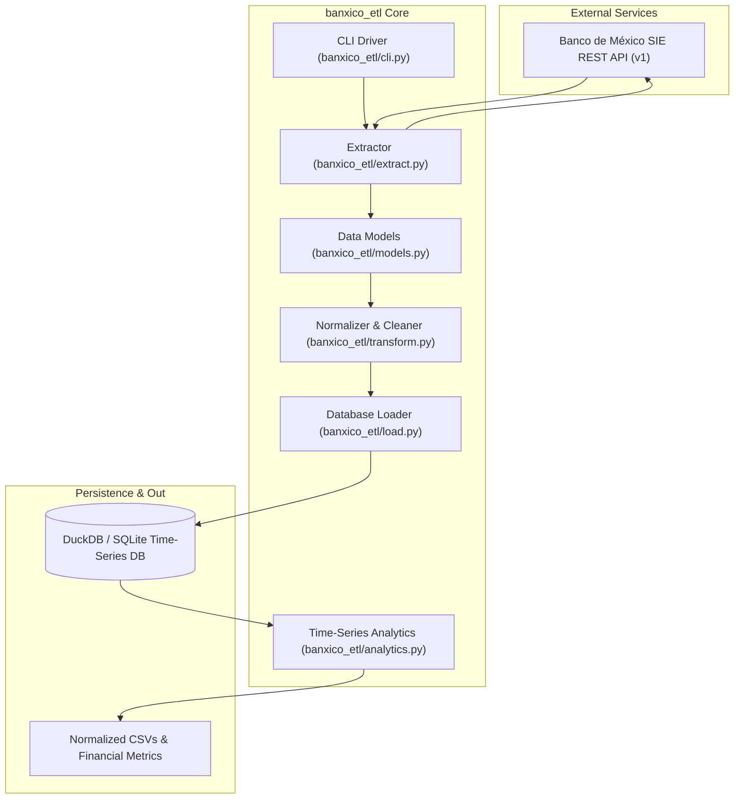
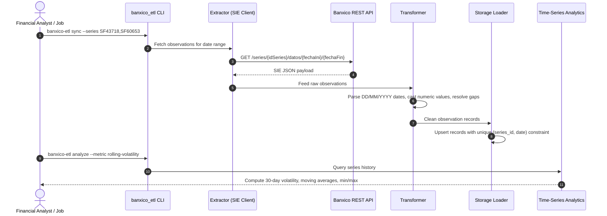

# 🏛️ Banxico Series Pipeline Architecture & Topology

Automated ETL data pipeline extracting, validating, and analyzing macroeconomic time-series from the Banco de México (Banxico) Economic Information System (SIE) API. Built with Python 3.12, Pydantic, Requests, DuckDB, and SQLite.

---

## 1. Technology Stack

| Layer | Technology | Details |
| :--- | :--- | :--- |
| **Runtime** | Python 3.12+ | Strict type annotations, asynchronous friendly structure |
| **API Client** | `requests` / `urllib3` | Authenticated HTTP client with exponential backoff and retry policies |
| **Validation** | `pydantic` v2 | Strict parsing of Banxico SIE JSON envelopes and observation arrays |
| **Data Transformation** | `pandas` / `numpy` | Time-series normalization, forward fills, rolling averages |
| **Analytical Store** | SQLite / DuckDB | Time-partitioned tables indexed by series ID and observation date |
| **CLI & Automation** | `argparse` / Cron | Parameterized daily syncs and export tasks |

---

## 2. System Topology & Component Graph



---

## 3. Data Processing Lifecycle



---

## 4. Directory Structure & Module Breakdown

```
banxico-series-pipeline/
├── banxico_etl/              # Core pipeline package
│   ├── extract.py            # Banxico SIE API client with authentication & retry logic
│   ├── transform.py          # Observation cleaning, date parsing, gap handling
│   ├── load.py               # SQLite/DuckDB loader and schema migrations
│   ├── models.py             # Pydantic schemas for series metadata and points
│   ├── analytics.py          # Volatility, yield curves, moving averages
│   └── cli.py                # Command-line interface for manual & scheduled runs
├── tests/                    # Pipeline validation test suite
│   └── test_etl.py           # Unit tests with mocked Banxico API responses
├── pyproject.toml            # Project packaging & dependencies
└── requirements.txt          # Runtime dependencies
```
